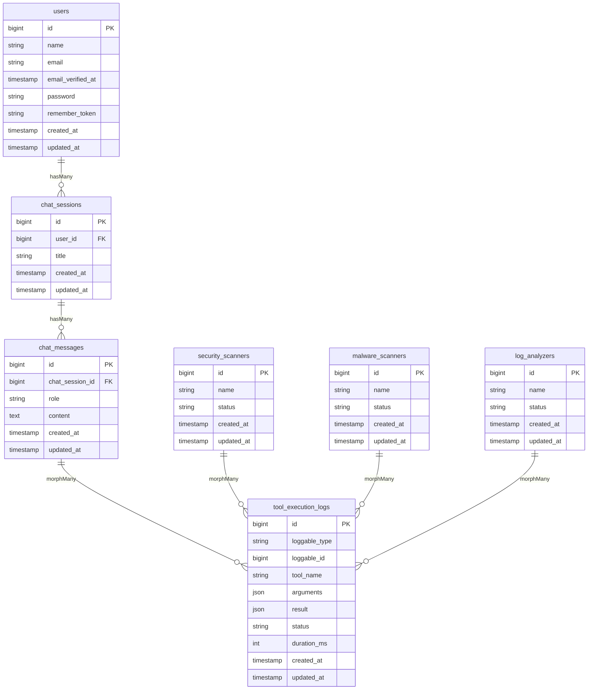
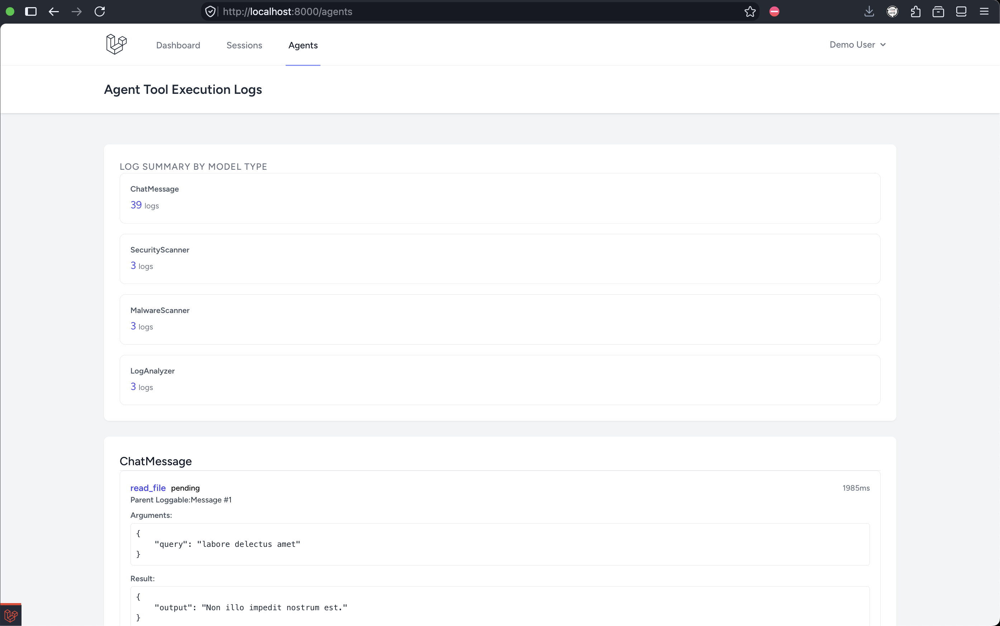
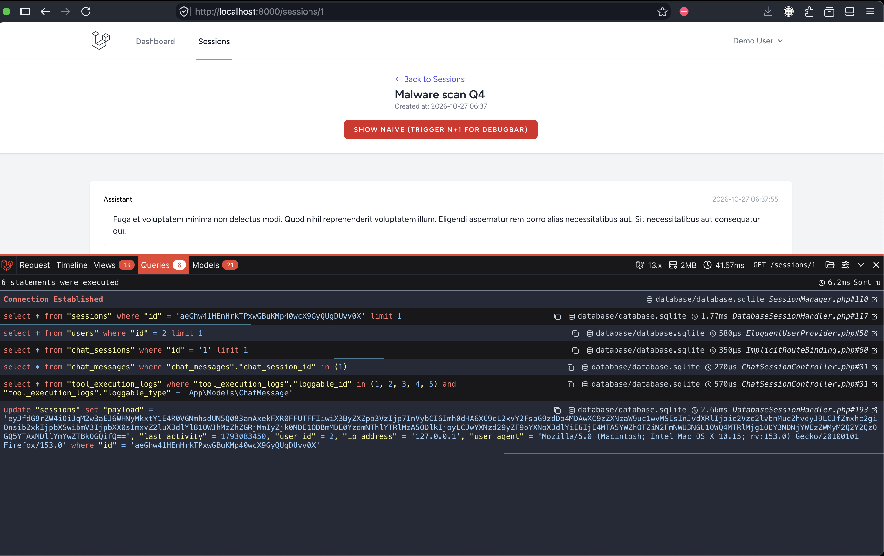
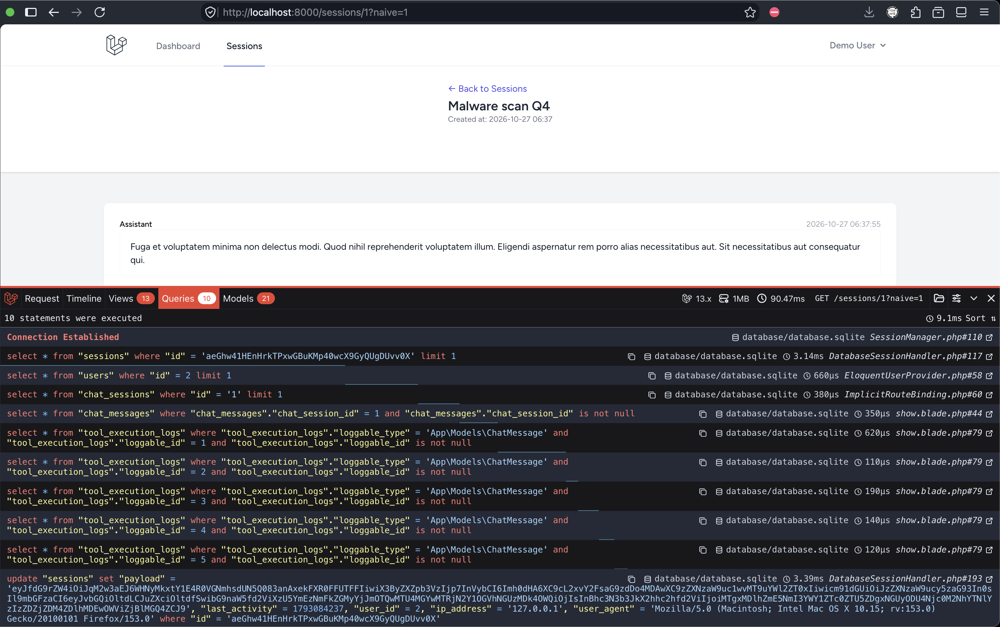

# Agentic AI Platform -  Database Modeling (Pertemuan 9)

## Kelompok 2

| No | Nama | NIM |
|----|------|-----|
| 1  | Joaquin Fairuz Nawfal Ismono | 5025241106 |
| 2  | Muhammad Zahran Rizki Primanda | 5025241107 |
| 3  | Hasan Abdurrahman | 5025241114 |
| 4  | Bintang Ilham Pabeta | 5025241152 |
| 5  | Felix Aldorino | 5025241162 |

## Overview

This project implements a robust relational database schema and ORM architecture for an "Agentic AI Platform" as part of the 9th week group assignment. The platform models complex multi-turn user chat sessions, individual messages, and polymorphic tool execution logs generated by AI agents and security scanners.

The repository includes complete database migrations with strict foreign key cascading rules, Eloquent models with strongly-typed return annotations (`BelongsTo`, `HasMany`, `MorphMany`, `MorphTo`), database factories and seeders (`ChatDemoSeeder`), an N+1 optimized chat session viewer with a live debug demonstration toggle, and a polymorphic agent log overview page (`/agents`).

## Schema / ERD



## Relationships Implemented

- User hasMany ChatSession
- ChatSession belongsTo User, hasMany ChatMessage
- ChatMessage belongsTo ChatSession, morphMany ToolExecutionLog (via loggable)
- ToolExecutionLog morphTo loggable
- SecurityScanner, MalwareScanner, LogAnalyzer each morphMany ToolExecutionLog

## Tantangan 1 — Polymorphic Logging

The `tool_execution_logs` table utilizes Laravel's polymorphic relation via `morphs('loggable')`, which generates `loggable_type` (string) and `loggable_id` (unsignedBigInteger) columns along with a composite index. This design allows a single unified logging table to store tool execution events for any Eloquent model in the application without requiring duplicate table structures or rigid foreign key constraints.

This architecture enables the same logging infrastructure to seamlessly serve traditional conversational chat tool calls (`ChatMessage`) as well as autonomous background agent types (`SecurityScanner`, `MalwareScanner`, and `LogAnalyzer`) dynamically and extensibly. See `docs/agents.png` — the `/agents` overview page groups execution logs by parent model type, illustrating all four model classes sharing the exact same log storage table.



## Tantangan 2 — N+1 Elimination

When rendering relational object graphs in web applications, accessing un-eager-loaded relations inside loops frequently triggers the N+1 query problem. Without optimization, retrieving chat messages and their associated tool execution logs results in 1 initial query for the session, 1 query for the messages collection, and N additional queries (one per message) to fetch logs, leading to 1 + N query overhead.

To solve this, `ChatSessionController::show()` implements nested eager loading via `$chatSession->load('chatMessages.toolExecutionLogs')`. This batches the retrieval of both levels into exactly 2 optimized queries (utilizing SQL `IN (...)` clauses) regardless of the number of messages or tool calls present in the session.

|  |  |
| :--: | :--: |
| Optimized (6 queries) | Simulated Naive Retrieval (10 queries) |

The optimized view fetches all related messages and logs in a minimal number of queries, whereas the naive toggle (`?naive=1`) intentionally bypasses eager loading to demonstrate the performance degradation and query spike visible in Laravel Debugbar.

## Setup & Run

Execute the following commands in your terminal:

```bash
composer install
npm install && npm run build
cp .env.example .env
php artisan key:generate
php artisan migrate:fresh --seed
php artisan serve
```

Log in with `demo@example.com` / `password`. Seeded data includes 1 demo user, 3 chat sessions with 5 messages each, and polymorphic tool execution logs across all 4 model types (totaling 41 logs for chat messages plus scanner-generated logs).

## Rubric Compliance

| Rubric | Weight | Evidence |
|--------|--------|----------|
| Rancangan Skema & Migrasi | 35% | `database/migrations/` — 6 migrations with `constrained()->onDelete('cascade')` and `morphs('loggable')` |
| Implementasi Model & ORM | 25% | `app/Models/` — typed `HasMany`, `BelongsTo`, `MorphMany`, `MorphTo` methods |
| Optimasi Eager Loading | 20% | `ChatSessionController@show` + screenshots in `docs/` |
| Polymorphic Logging (A+) | 10% | `ToolExecutionLog` + 3 scanner models + `/agents` page |
| Kerapian Kode & PSR-12 | 10% | `./vendor/bin/pint --test` passes on all files |

## Screenshots

- `docs/agents.png` — Overview of polymorphic tool execution logs grouped by agent and message model types on the `/agents` page.
- `docs/n+1-optimized.png` — Laravel Debugbar query performance when nested eager loading (`load('chatMessages.toolExecutionLogs')`) is active.
- `docs/n+1-naive.png` — Laravel Debugbar query breakdown showing the N+1 query spike when lazy loading is triggered via `?naive=1`.
